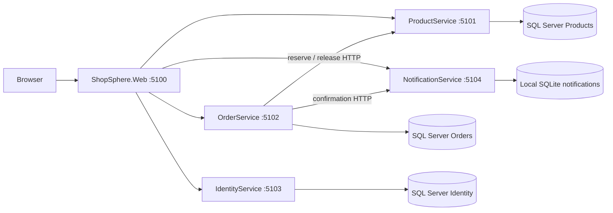

# Architecture

## Boundaries

Shared contains DTOs, validation, JWT registration, problem handling and HTTP helpers. It contains no DbContext. MVC has no EF dependency or database connection. Each service has controllers, business logic, dependency injection and its own configuration. HTTP calls have bounded timeouts. EF Core accesses only the owning service's database.

## Purchase and recovery

1. MVC stores product IDs and quantities in a session cart. Displayed prices come from ProductService.
2. Checkout submits a session-stable request UUID, shipping address and quantities. Identity comes exclusively from validated JWT claims, never from the posted customer ID. The browser supplies neither purchase prices nor roles.
3. OrderService validates the request and persists the order intent (`PendingInventory`) before making a remote call. UUID primary keys provide idempotency. A repeat with different user/address/items returns 409.
4. ProductService reserves inventory in one serializable transaction and records immutable name/price snapshots for the order UUID. Retries return the same reservation without consuming stock twice. Missing/inactive/insufficient inventory rolls back all items. Database constraints prevent negative stock.
5. OrderService records the snapshots and moves to `Confirmed`. Validation/availability refusal becomes a persisted `Rejected` order; no payment was taken. The API returns 201 with the resulting order. A dependency outage leaves `PendingInventory` and returns 202. Clients must inspect the status, including `Rejected`.
6. Confirmation delivery uses the separate NotificationService. Its unique order key prevents duplicate local confirmations. A delivery outage leaves the confirmed order intact and the unsent flag persisted.
7. An OrderService background worker retries pending reservations, pending cancellations and unsent confirmations every 15 seconds (up to 50 orders per pass, ordered by their oldest attempt so failures do not starve later orders). A database lease prevents concurrent workers processing an order. A crashed worker's lease expires in two minutes. Restart resumes persisted work.
8. Administrators advance `Confirmed → Processing → Shipped → Delivered`. Only `Confirmed` may be cancelled. The intermediate `CancelPending` state persists before the product reservation is released; successful release moves it to `Cancelled`. Repeated release does not add inventory twice.

The database lease and idempotent reservation/confirmation APIs cover the usual crash windows without a cross-service database transaction. SQL Server can reject contending serializable transactions as deadlocks; callers see a retryable service failure and persisted orders are retried. No HTTP transport retry is applied blindly to non-idempotent operations.

## Security and request handling

- ASP.NET `PasswordHasher<T>` salts and hashes passwords; login can rehash when settings change. Registration can only create Customers. Admins are created through opt-in local configuration seeding.
- HS256 JWTs validate signature, issuer, audience and expiry; customer ID uses `sub`, authorization uses `role`. MVC uses an encrypted, HTTP-only cookie and keeps the JWT in its protected authentication ticket. Cookie expiration follows JWT expiry.
- MVC POST forms require antiforgery tokens; service API writes require JWTs/roles or the separate internal service key. Internal service keys are compared in constant time. Keep these endpoints on trusted local/network paths and use HTTPS outside local development.
- Registration/login have per-IP fixed-window rate limiting. Account messages are generic at login. Roles are enforced by the API even if callers bypass MVC.
- `[ApiController]` produces validation problems; centralized exception handling returns problem JSON with trace IDs. Unexpected exception details stay in structured server logs. MVC gives validation summaries, flash results, busy submit states and a service-unavailable page.

## Deliberate limits

This is a complete core practice application, not a production marketplace. There is no real payment processor, tax/shipping engine, email delivery, password reset, refresh token, revocation store, 2FA, multi-currency or image upload. Seeded product visuals are CSS artwork. Tokens last 60 minutes; local sign-out removes the cookie but does not revoke a copied JWT. Secrets are shared symmetric keys for local simplicity. Sessions and rate-limit counters are process-local. Notification SQLite persistence is local to its process filesystem. Recovery runs while OrderService is alive; requests have eventual results during outages. Shipping/customer data is stored for this practice workflow; no data retention system is included. Database tests use SQLite, so a separate SQL Server smoke test is still required for provider-specific behavior. Infrastructure and deployment configuration are outside the requested scope.
